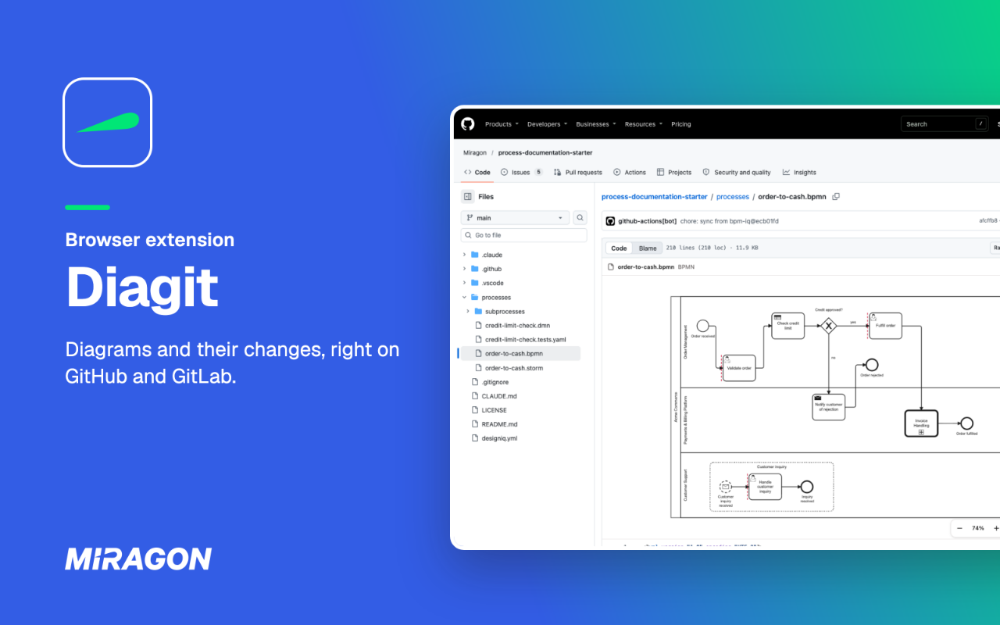
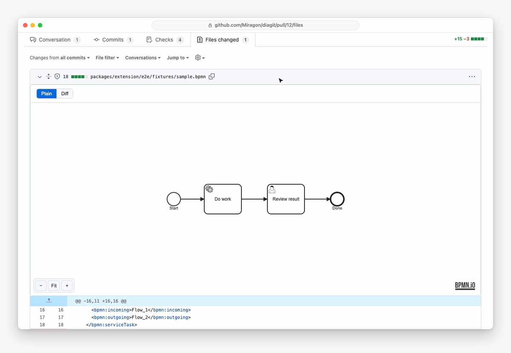

# Diagit

**See your diagrams on GitHub and GitLab, and what changed in a BPMN process right in the pull request.**

Diagit is a browser extension for Chrome, Edge and Firefox. Open a model file in a repository and Diagit draws the diagram above its source. Open a pull or merge request that changes a `.bpmn` file and you get the old and the new process side by side, with every change marked. The page, the source and the text diff stay as they are; Diagit only adds to them.

## Why

A process, a Wardley Map or a team topology kept in Git is a text file. On GitHub or GitLab you see its source, and a review of a process change is a wall of `<bpmn:sequenceFlow>`: you cannot see what moved, what was added or what was removed.

Diagit puts the diagram back where you read and review it. It draws the model on the file page and, for BPMN, marks the added, removed, changed and moved elements over a before/after view in the pull request.

## What you get

- **Diagrams on the file page.** Open a supported file and the diagram appears above the source. Drag to pan, zoom with **−**, **+** and **Fit**.
- **A visual diff for BPMN.** Every changed `.bpmn` file in a pull request, a merge request or a GitHub commit gets a before/after view that marks added, removed, changed and moved elements, including `zeebe:*` properties. **Next** and **Prev** step through the changes. See [Review a model change](https://miragon.github.io/diagit/review-changes).
- **Your instances too.** github.com and gitlab.com work right away. A self-hosted GitLab or GitHub Enterprise needs one click on the toolbar icon to allow its domain. See [Self-hosted instances](https://miragon.github.io/diagit/self-hosted).
- **Private repositories.** On GitLab and GitHub Enterprise Diagit uses the login you already have. For private repositories on github.com you connect a read-only GitHub App once. See [Private repos on github.com](https://miragon.github.io/diagit/private-repos).
- **Files from your disk.** A built-in viewer page opens a local model file in the browser; nothing leaves your machine. See [Open a file from your disk](https://miragon.github.io/diagit/notations#open-a-file-from-your-disk).

| Notation        | File endings       | File page | PR / MR diff |
| --------------- | ------------------ | --------- | ------------ |
| BPMN            | `.bpmn`            | yes       | yes          |
| DMN             | `.dmn`             | yes       | not yet      |
| Wardley Map     | `.owm`, `.wmap`    | yes       | not yet      |
| Team Topologies | `.tt`, `.ttm.json` | yes       | not yet      |
| Event Storming  | `.storm`           | yes       | not yet      |
| Context Map     | `.cm`, `.cm.json`  | yes       | not yet      |
| Value Chain     | `.vc`, `.vc.json`  | yes       | not yet      |
| Excalidraw      | `.excalidraw`      | yes       | not yet      |

## Install

1. Add Diagit from your browser's store: [Chrome Web Store](https://chromewebstore.google.com/detail/diagit/bjphfmmlciflmdcnpfpbnkmgnkiabfdh), [Firefox Add-ons](https://addons.mozilla.org/firefox/addon/diagit/) or [Edge Add-ons](https://microsoftedge.microsoft.com/addons/detail/pphcelcgicmpdkkbginmkdogceepigen). There is nothing to configure for github.com and gitlab.com.
2. Open a model file in a repository, for example a `.bpmn` file. Diagit draws the diagram above the source.
3. Open a pull request that changes a `.bpmn` file, go to **Files changed** and switch the Diagit panel from **Plain** to **Diff**.

The full walk-through, with troubleshooting, is in [Getting started](https://miragon.github.io/diagit/getting-started). To build the extension from source and load it unpacked, see [CONTRIBUTING.md](CONTRIBUTING.md#loading-the-extension-unpacked).

## Privacy

Diagit collects no data and has no server. File contents only travel between your browser and the Git host you are viewing. See [PRIVACY.md](PRIVACY.md) and [Privacy and permissions](https://miragon.github.io/diagit/privacy).

## Credits

- [bpmn-js](https://github.com/bpmn-io/bpmn-js) and [dmn-js](https://github.com/bpmn-io/dmn-js) by [bpmn.io](https://bpmn.io) draw BPMN and DMN.
- The renderers of the Miragon modelers draw Wardley Maps, Team Topologies, Event Storming, Context Maps and Value Chains.
- [Excalidraw](https://github.com/excalidraw/excalidraw)'s own export code draws Excalidraw files.

## Documentation and feedback

The [documentation](https://miragon.github.io/diagit/) explains every feature, setup step and limit.
Found a bug or missing something? Open an [issue](https://github.com/Miragon/diagit/issues).
Report security issues privately, as described in [SECURITY.md](SECURITY.md).
How to build, test and change the project is in [CONTRIBUTING.md](CONTRIBUTING.md).

## License

[MIT](LICENSE) © Miragon GmbH
